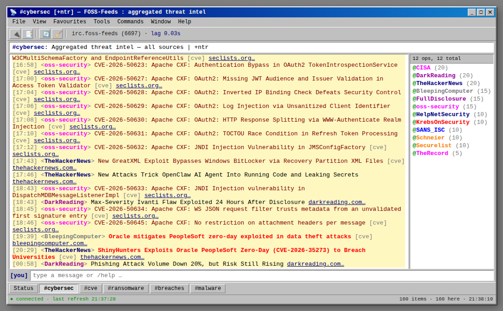

# 📡 FOSS-Feeds

A self-hosted **cybersecurity RSS aggregator** with an unapologetically **old-school IRC channel** UI. Feed sources show up as "nicks" in the channel, headlines arrive as chat lines, and you can filter by category like joining different channels — all served from a single lean Node container with zero build step.



> It's an RSS reader in a trench coat pretending to be an IRC client. The "server", "channels", and "nicks" are all painted over a feed parser — there is no actual IRC protocol involved.

## Features

- **12 cybersecurity feeds** out of the box (The Hacker News, BleepingComputer, Krebs, Dark Reading, SANS ISC, CISA, The Record, Securelist, Schneier, Help Net Security, Full Disclosure, oss-security) — easily edited.
- **IRC channel UI** — white buffer, colour-coded nicks, a nicklist of "ops", a switchbar of channels, working `/commands` (`/join`, `/query`, `/names`, `/clear`, `/refresh`, `/topic`).
- **Auto-categorisation** — each item is tagged `cve` / `ransomware` / `breach` / `malware` / `news` and a severity (`crit` / `warn` / `info`) from its headline, so you get `#cve`, `#ransomware`, `#breaches`, `#malware` channels for free.
- **Embedded persistence** — items and alert state are stored in [NeDB](https://github.com/seald/nedb) (file-backed, no DB server), so overnight items and unsent alerts survive restarts.
- **Optional scheduled push alerts** via [ntfy](https://ntfy.sh) — batched crit/warn pushes inside a configurable daily window, plus a morning briefing of overnight activity. Off by default.
- **Two ways to run it** — as a self-hosted container, or as a **serverless static site** rebuilt on a schedule by GitHub Actions and served from GitHub Pages.

## Quick start

```bash
git clone <your-fork-url> foss-feeds && cd foss-feeds
cp .env.example .env          # optional — edit for ntfy alerts
docker compose up -d --build
```

Open <http://localhost:3004>. Behind a reverse proxy, point a hostname at it and set `PUBLIC_URL` so alert links resolve.

The container runs as the unprivileged `node` user (uid 1000), so the bind-mounted `./data` directory must be writable by it: `sudo chown -R 1000:1000 data`.

Without Docker (Node 22+):

```bash
npm ci
DATA_DIR=./data npm start     # http://localhost:3004
```

## Public static site (no server)

The same UI can run with no server at all. A scheduled workflow ([`.github/workflows/publish.yml`](.github/workflows/publish.yml)) fetches the feeds every 15 minutes, writes `api/feeds.json` next to the static front-end, and deploys the lot to GitHub Pages. Open pages pick up new items on their normal 30-second poll.

```bash
npm ci
npm run build:static          # -> dist/  (serve it with any static file server)
```

History is carried forward from the previously published `api/feeds.json` (set `PREV_URL`), so items persist for `RETENTION_DAYS` without a database. If the previous build can't be fetched, the build fails rather than deploying a site with its history wiped. The static site has no push alerts.

To switch on the deploy in your fork: **Settings → Pages → Build and deployment → Source: GitHub Actions**. No secrets are needed. The site appears at `https://<you>.github.io/<repo>/`.

GitHub Pages can't send custom headers, so the static site's Content-Security-Policy is a `<meta>` tag in [`public/index.html`](public/index.html).

## Configuration

All via environment variables (see [`.env.example`](.env.example)); everything has a sensible default.

| Variable | Default | Purpose |
| --- | --- | --- |
| `PORT` | `3004` | HTTP port |
| `REFRESH_MIN` | `5` | Feed fetch interval (minutes) |
| `DATA_DIR` | `/data` | Where NeDB files live |
| `RETENTION_DAYS` | `7` | Drop items this many days after first seen |
| `PUBLIC_URL` | `http://localhost:$PORT` | Base URL used in alert links |
| `TZ` | `Europe/London` | Timezone for the alert schedule |
| `NTFY_URL` | _(unset)_ | ntfy topic URL — **unset disables all push alerts** |
| `ALERT_LEVELS` | `crit,warn` | Severities that trigger a push |
| `ALERT_WINDOW_START` / `ALERT_WINDOW_END` | `09:00` / `17:30` | Daily window alerts may send in |
| `ALERT_EVERY_MIN` | `15` | Batched-flush cadence inside the window |
| `SUMMARY_AT` | `09:00` | Time of the daily morning briefing |
| `SUMMARY_LOOKBACK_H` | `16` | How far back the briefing summarises |

## Editing the feeds

The feed list is the `FEEDS` array in [`lib/feeds.js`](lib/feeds.js), shared by the server and the static build:

```js
const FEEDS = [
  { source: 'TheHackerNews',    url: 'https://feeds.feedburner.com/TheHackersNews' },
  { source: 'BleepingComputer', url: 'https://www.bleepingcomputer.com/feed/' },
  // …add / remove as you like; `source` becomes the nick shown in-channel
];
```

`source` is the displayed nick; any standard RSS/Atom feed works (not just security ones).

## How it works

Self-hosted:

```
RSS feeds ──poll(5m)──> server.js ──categorise/dedupe──> NeDB (/data)
                                          │
   browser ──poll(30s)──> /api/feeds.json ┘──> IRC UI (public/)
                                          └──> ntfy push alerts (optional)
```

Static:

```
RSS feeds ──Actions cron(15m)──> build-static.js ──> dist/api/feeds.json ──> GitHub Pages
                                       ▲                                          │
                                       └──── previous api/feeds.json (history) ───┤
                                          browser ──poll(30s)──> IRC UI (public/) ┘
```

No database server, no frontend framework, no front-end build — Express serving JSON plus a static page, or just the static page.

Feed links are third-party input, so only `http(s)` URLs are ever rendered as links, and both modes send a strict Content-Security-Policy.

## Maintenance

The repo keeps its own dependencies current, safely:

- **Dependabot** ([`.github/dependabot.yml`](.github/dependabot.yml)) opens weekly update PRs for the npm packages, the Docker base image, and the GitHub Actions themselves.
- **CI** ([`.github/workflows/ci.yml`](.github/workflows/ci.yml)) runs a smoke test on every PR — it installs the locked dependencies (`package-lock.json`), boots the server, checks `/health`, and runs the static build.
- Only if that smoke test passes are **patch/minor** Dependabot PRs queued for auto-merge; they merge as soon as the code owner approves. **Major** bumps are left open for a human. So updates that would break startup never merge, and nothing merges unreviewed.

Security checks run on every PR, on every push to `main` and weekly:

- **Secrets:** [gitleaks](https://github.com/gitleaks/gitleaks) scans the full git history ([`security.yml`](.github/workflows/security.yml)), and GitHub secret scanning with push protection blocks known token formats before they land.
- **SCA:** `npm audit` on the locked production tree, plus GitHub's dependency review blocking PRs that add a package with a known high/critical vulnerability. Dependabot alerts and security updates are on.
- **SAST:** [CodeQL](https://codeql.github.com/) (`security-extended` queries) analyses the JavaScript and the GitHub Actions workflows ([`codeql.yml`](.github/workflows/codeql.yml)).

`main` is protected by a ruleset: changes land only through pull requests, with a green CI and a review from the owner in [`.github/CODEOWNERS`](.github/CODEOWNERS). Forks wanting the same flow need **Settings → General → Allow auto-merge** enabled.

## License

[MIT](LICENSE) © 2026 Lee Gardiner. A nostalgia tribute; not affiliated with any IRC client or network.
